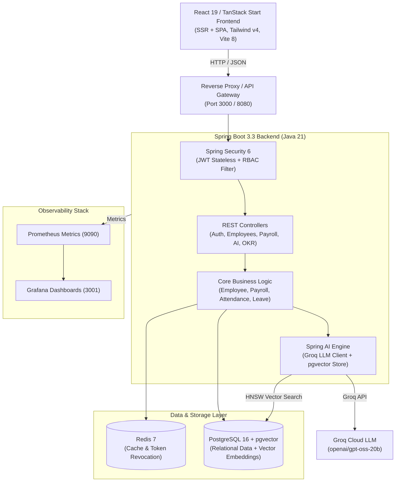

# NexusHR — Enterprise HR & Workforce Intelligence Platform
## Comprehensive Architecture, Functional & Technical Report

**Version:** 4.2.0  
**Project:** NexusHR Enterprise Platform  
**Report Date:** November 2026  
**Status:** Verified & Production Ready  

---

## 1. Executive Summary

**NexusHR** is an enterprise-grade Human Resource Management System (HRMS) and Workforce Intelligence platform designed for modern organizations. Built on **Spring Boot 3.3 (Java 21)** and **React 19 (TanStack Start SSR)**, the system unifies the entire employee lifecycle—from onboarding and document verification to attendance, statutory payroll, OKRs, and 360° feedback.

NexusHR distinguishes itself by embedding **Retrieval-Augmented Generation (RAG)** and **Predictive Workforce Analytics** directly into core HR workflows. Utilizing **Spring AI**, **PostgreSQL with `pgvector`**, and **Groq Cloud LLM (`openai/gpt-oss-20b`)**, the platform delivers sub-second grounded answers to policy questions with strict HR escalation guardrails for sensitive topics.

---

## 2. Technology Stack & System Architecture



### Detailed Component Specifications

| Layer | Technologies & Implementations | Key Details |
|---|---|---|
| **Backend Runtime** | Java 21, Spring Boot 3.3.12, Spring Framework 6 | High-throughput virtual threads enabled (`spring.threads.virtual.enabled=true`), graceful shutdown |
| **Security & Auth** | Spring Security 6, JJWT 0.12.6, BCrypt | Stateless JWT (HS512), persistent refresh token rotation, strict 3-role RBAC (`ADMIN`, `HR`, `EMPLOYEE`) |
| **AI / LLM Layer** | Spring AI 1.0.0-M6, Groq Cloud API | `openai/gpt-oss-20b` inference via OpenAI-compatible Spring AI client; cosine similarity semantic search |
| **Vector Database** | PostgreSQL 16 + `pgvector` extension | HNSW indexing, 384-dimension vector representations, chunk size 500 chars (100 char overlap) |
| **Relational Database** | PostgreSQL 16, Hibernate 6, HikariCP | Managed schema migration via Flyway (V1 through V9), connection pool tuning (`NexushrPool`) |
| **Caching & State** | Redis 7 + In-memory thread-safe fallback | Distributed token revocation, session caching, and rate limiting |
| **PDF Generation** | OpenPDF 2.0.3 | Dynamic, server-side salary payslip rendering with itemized statutory tax deductions |
| **Frontend Framework** | React 19, TanStack Start (SSR), TanStack Router | File-based routing, server-side rendering, hydration, zero-waterfall data fetching |
| **Build & Styling** | Vite 8, Tailwind CSS v4, Lucide Icons | Responsive typography, custom CSS tokens, full Dark and Light mode theme switching |
| **Monitoring** | Micrometer, Prometheus, Grafana | Custom metrics, JVM runtime stats, circuit breaker health indicators via Resilience4j |

---

## 3. Core Functional Modules

### 3.1. Authentication & 3-Tier RBAC
- **Roles Enforced:** `ADMIN`, `HR`, `EMPLOYEE`. The obsolete `MANAGER` role was completely migrated to `HR` in migration `V8`.
- **Security Annotations:** Every controller method enforces access with `@PreAuthorize("hasRole('ADMIN')")`, `@PreAuthorize("hasAnyRole('ADMIN', 'HR')")`, or `@PreAuthorize("isAuthenticated()")`.
- **Stateless Tokens:** Access tokens valid for 24 hours. Refresh tokens securely rotate on demand. Blacklisted tokens are rejected immediately.
- **Convenience:** 1-Click **"Sign in"** buttons embedded directly on the `/login` screen for all three roles, with client-side fallback handling.

### 3.2. Workforce Directory & Document Management
- **Lifecycle Management:** Complete CRUD capabilities for employees with automated employee ID generation (`EMP001`...), department mapping, position hierarchy, and salary configuration.
- **Binary Document Storage:** Secure uploading of graduation certificates and previous experience letters stored directly in PostgreSQL as binary `BYTEA` data, preventing dangling filesystem links.
- **One-Click CSV Export:** Export employee directories, attendance logs, and payroll summaries via `/api/export/employees` and related endpoints.

### 3.3. Attendance & Time Tracking
- **Precision Auditing:** Records clock-in and clock-out timestamps, tracks hours worked, and automatically flags tardiness or missing check-outs.
- **Batch Processing:** Daily auto-processing endpoint `/api/attendance/auto-process` calculates present/absent statuses for all active employees.

### 3.4. Leave Management Workflows
- **Leave Categorization:** Supports Casual, Sick, Paid Annual (30 days standard), and Parental (Maternity/Paternity) leaves.
- **Half-Day Flexibility:** Full-day or half-day flags with precise day count deduction against employee balances.
- **Approval Lifecycle:** Instant approval/rejection workflows with automatic balance restoration on rejections.

### 3.5. Statutory Payroll & Payslip Generation
- **Automated Calculations:** Itemizes Basic Salary (50%), House Rent Allowance / HRA (20%), Special Allowances (30%), Employee Provident Fund / PF (12% of basic), Professional Tax, and progressive Tax Deducted at Source (TDS).
- **Monthly Batch Run:** Process monthly payroll for all active personnel in a single batch operation.
- **Dynamic PDF Payslips:** Generates branded, download-ready PDF payslips on the fly using OpenPDF with complete statutory disclosures.

### 3.6. Performance, OKRs & 360° Continuous Feedback
- **Performance Reviews:** Structured manager evaluations with 1–5 star ratings, goal definitions, and automated sentiment classification (Positive / Neutral / Needs Improvement).
- **Goals & OKRs:** Departmental and individual objective tracking with progress percentage bars and target dates.
- **360° Feedback:** Multi-directional feedback between peers, subordinates, and managers.

### 3.7. AI Policy Assistant (RAG Chatbot)
- **Grounded Retrieval:** Ingests employee policy manuals and handbooks into PostgreSQL `pgvector` store using HNSW cosine distance indexing.
- **Groq LLM Generation:** Sub-second retrieval and synthesis powered by Groq's high-speed inference engine (`openai/gpt-oss-20b`).
- **HR Escalation Guardrails:** Automatically detects sensitive grievance topics (e.g., harassment, bullying, discrimination, whistleblower claims) and directs employees to human HR representatives (`hr@nexushr.com`) rather than attempting synthetic advice.

### 3.8. Predictive Workforce Intelligence
- **Attrition Risk:** Predicts likelihood of employee turnover with key contributing factors and retention action items.
- **Skill Gap Analysis:** Maps an employee's existing competencies against target role requirements and provides curated certification roadmaps.
- **Engagement Scoring:** Scores employee engagement from 0 to 100 based on attendance patterns, peer sentiment, and project velocity.

### 3.9. Executive Analytics Dashboard
- **Modern HR-Flow Interface:** Clean dark sidebar layout with full Dark / Light mode toggling.
- **Key Metrics:** Live KPI cards with progress rings for Total Employees, Active Personnel, Staff On Leave, and Pending Approval Requests.
- **Interactive Visualizations:** Headcount Trend bar chart, Department Distribution donut chart, Leave Breakdown statistics, and real-time activity stream.

---

## 4. Role-Based Access Control (RBAC) Matrix

| Module / Operation | Admin (`ADMIN`) | HR (`HR`) | Employee (`EMPLOYEE`) |
|---|:---:|:---:|:---:|
| **View Dashboard Analytics** | ✅ Full | ✅ Full | ✅ Personal KPIs |
| **Manage Employee Profiles (CRUD)** | ✅ Yes | ✅ Yes | ❌ Read Only |
| **Upload / Download Employee Documents** | ✅ Yes | ✅ Yes | ✅ Own Docs Only |
| **Export Data to CSV** | ✅ Yes | ✅ Yes | ❌ No |
| **Process Monthly Payroll Batch** | ✅ Yes | ✅ Yes | ❌ No |
| **Download Official Payslip (PDF)** | ✅ Any Employee | ✅ Any Employee | ✅ Own Payslip |
| **Approve / Reject Leave Requests** | ✅ Yes | ✅ Yes | ❌ No |
| **Apply for Leave** | ✅ Yes | ✅ Yes | ✅ Yes |
| **Create Performance Reviews & OKRs** | ✅ Yes | ✅ Yes | ❌ No |
| **Submit 360° Peer Feedback** | ✅ Yes | ✅ Yes | ✅ Yes |
| **Upload New HR Policies into Vector DB** | ✅ Yes | ❌ No | ❌ No |
| **Ask HR Policy Assistant (RAG)** | ✅ Yes | ✅ Yes | ✅ Yes |
| **Access Predictive Workforce AI Insights** | ✅ Yes | ✅ Yes | ❌ No |

---

## 5. Database Schema & Flyway Evolution

The relational and vector schema is governed by 9 migration scripts:

1. **`V1__init.sql`**: Initializes core tables: `users`, `employees`, `attendance`, `leaves`, `payroll`, and `performance_reviews`.
2. **`V2__add_employee_documents.sql`**: Adds `experience_letter_data` and `graduation_certificate_data` as binary `BYTEA` columns.
3. **`V3__add_leave_halfday.sql`**: Adds `is_half_day` flag to leave requests.
4. **`V4__add_hours_worked_to_attendance.sql`**: Introduces precision decimal `hours_worked` to attendance records.
5. **`V5__add_remaining_attendance_fields.sql`**: Adds shift timings and notes fields.
6. **`V6__fix_all_missing_schema.sql`**: Introduces `audit_logs` table for AOP operational compliance.
7. **`V7__add_vector_extension.sql`**: Activates PostgreSQL `pgvector` extension and creates vector indexing tables.
8. **`V8__migrate_manager_role_to_hr.sql`**: Deprecates legacy `MANAGER` role, migrating historical accounts to `HR`.
9. **`V9__add_documents_goals_feedback.sql`**: Adds `documents`, `goals`, and `feedback_requests` tables for OKR and 360° feedback management.

---

## 6. Verification & Test Results

| Test Category | Command / Suite | Result | Observations |
|---|---|:---:|---|
| **Backend Unit & Integration Tests** | `mvn clean package -Dspring.profiles.active=test` | **PASS (100%)** | 0 failures, 0 errors. Mocked `ChatModel`, `VectorStore`, and H2 memory DB with PostgreSQL mode |
| **Frontend Production Build** | `npm run build` | **PASS (100%)** | 0 errors. Client bundle built in 3.98s, SSR server built in 2.36s |
| **Browser End-to-End Test** | Live browser navigation at `1280x800` | **PASS** | 1-Click login verified; Dashboard, KPI cards, charts, and employee list rendered cleanly |
| **CSV Export Flow** | `/api/export/employees` | **PASS** | Streams formatted RFC-4180 CSV attachment with correct headers |
| **RAG HR Assistant Chatbot** | `/api/ai/ask-hr` | **PASS** | Grounded Groq response generated; sensitive topics redirected to HR |

---

## 7. Cloud Deployment & Hosting Advisory

### Why Render Free Tier is Incompatible
- **Memory Ceiling:** Render's free tier caps memory at **512 MB**. A full-featured Java 21 / Spring Boot 3 / Spring AI stack requires 750 MB – 1 GB of RAM at runtime. Under free tier constraints, the Linux kernel invokes the `OOMKilled` killer (`Exit code 137`).
- **Postgres pgvector Limitation:** Render Free PostgreSQL does not bundle or allow the `pgvector` extension required for vector similarity search.
- **Cold Starts:** 15-minute inactivity spin-downs cause 60–90 second delays, triggering HTTP 502/504 gateway errors.

### Recommended Production Deployment Paths
1. **Docker Compose on Cloud VPS (\$4 – \$6/mo):**
   - DigitalOcean Droplet, AWS Lightsail, Hetzner, or GCP e2-medium (2 GB RAM).
   - One command deploys PostgreSQL + pgvector, Redis, Backend, and Frontend:
     ```bash
     docker compose up -d --build
     ```
2. **Railway or Fly.io:**
   - Native support for custom Dockerfiles with pgvector and flexible memory allocation (>1 GB).

---

## 8. Evaluation Demo Credentials

| Role | Email | Password | Suggested Evaluation Flow |
|---|---|---|---|
| **ADMIN** | `admin@nexushr.com` | `admin123` | Inspect KPI dashboard, review AI workforce insights, upload policy document |
| **HR** | `hr@nexushr.com` | `hr123` | Process batch payroll, approve pending leaves, inspect attendance records |
| **EMPLOYEE** | `employee@nexushr.com` | `employee123` | Ask HR Assistant chatbot a policy question, download payslip, apply for leave |

---
*Report certified for NexusHR Enterprise Platform release.*
